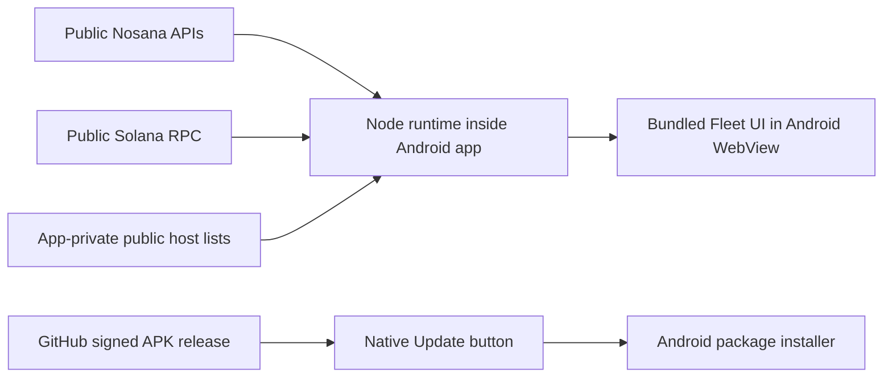

# GridLens for Android

The existing GridLens Fleet dashboard runs directly on Android, including its
public-data service. **The laptop can be off.** Internet access is still required
for current Nosana and Solana readings. This repository supports Android only;
the [desktop application](https://github.com/MachoDrone/gridlens-typescript)
continues independently.

**[Download the signed Android APK](https://github.com/MachoDrone/gridlens-android-releases/releases/latest/download/gridlens-android.apk)**

**Version 0.2.15** uses one list for choosing computers. Choose the computers once,
review their SSH identities, then sign in and inspect. Identity review asks for
approval of new identities for those computers without another checkbox list.
GridLens automatically saves every verified Nosana host found on the chosen
computers, including multiple hosts on one PC. Incomplete checks remain in the
final inspection details; unresolved host identities are never added to the fleet.

**Version 0.2.14** repairs search-field keyboard input in the native selection
screens and gives results a taller, separate scrolling area. The result count
means all matches for the current search and filter, including rows below the
screen. **Scroll for more results** makes that visible, and **Select all results**
selects every selectable match.

Computer rows now say whether an **SSH identity is saved in this profile**, and
the screen names the selected network profile. A missing saved SSH identity does
not mean the computer is unfamiliar, lacks Nosana, or has lost its saved fleet
data. SSH identity approval remains separate for each network profile. See
[verification](docs/VERIFICATION.md) for candidate checks, publication and
physical-phone acceptance.

**Version 0.2.13** introduced the native Network
Discovery presentation. Blue underlined actions have short descriptions, dialog
titles are green, and dialog buttons have visible outlines. First-time setup opens the
network settings directly. Search and bulk-selection controls help choose
computers, one identity review replaces repeated trust dialogs, and SSH sign-in
offers an existing SSH key first with a separate password option.

Versions 0.2.13–0.2.14 used a second selection of verified hosts after inspection;
0.2.15 replaces that step with automatic saving from the chosen computers.
The final **Fleet saved** screen shows counts and monitoring status;
**View inspection details** reveals individual results and **View fleet** closes
the summary. Physical phone acceptance remains separate from automated checks;
see [verification](docs/VERIFICATION.md).

**Version 0.2.12** includes automatic PC IP collection in normal discovery.
Choose **Inspect + automatic IP** on the native review screen. After successful
PC verification and fleet saving, the app uses the selected remembered SSH
credentials to keep IP addresses current while that fleet is open. No separate
IP-repair action or rewards/GPU-monitoring setup is needed for newly enrolled PCs.

**Inspect only** remains available. Credentials deliberately left unremembered
are not saved or used for automatic monitoring. Existing healthy monitoring,
manual pauses, revoked access, credential/identity restrictions and provider waits
are preserved; the save result explains any excluded PCs. Clean legacy inspection
records can receive PC-only approval through the same explicit review action.

**Version 0.2.11** adds a direct PC-only IP check. Tap a PC’s IP value, then
**Check / repair this PC’s IP**. The native screen verifies its saved SSH connection
and checks installed host curl without inspecting node containers. If PC-IP access
is missing or paused, native confirmation and verification of the saved SSH key
are required before it can resume. Existing node monitoring and wallet permissions
are preserved. The result screen reports the actual IP outcome or bounded failure.

SSH now prefers the already pinned host-key type when a server offers multiple
keys. A different offered key no longer causes a false identity-change pause when
the original saved key is still available. Genuinely changed keys remain rejected.
Provider waits, cache source times and explicit pause/revocation controls remain.

**Version 0.2.10** repairs PC IP scheduling and cached delivery. Unsupported or
malformed saved node information can no longer prevent an independently approved
PC IP check. The app also restores a missing received IP observation from its
native cache, preserving the original measurement time and provider waits.
Explicit monitoring approval can retain PC IP access when node binding verification
is unavailable. Existing SSH identity checks, credential rejection, manual pauses
and revocation remain enforced. No container renaming or host installation is
required.

**Version 0.2.9** collects public IP directly from each approved PC using its
installed `curl`, independently of Nosana containers and GPU collection. It uses
the saved SSH connection and pinned PC identity without sudo or package installs.
IPv4 is preferred, with IPv6 fallback after connectivity failures; provider refusals
and requested waits are preserved. Private addresses come from PC interfaces.

The IP toggle now cycles **hidden → both full addresses → external full → external
last octet → internal full → internal last octet → hidden**. IPv4 suffixes include
a leading dot, IPv6 stays complete, and missing values use **−**. Existing saved
modes remain supported. Toggle taps only change display; full addresses still sort.

PC network readings are shared with every associated host, including shared NAT
and public-only PCs, without overwriting rewards, GPU history or node status.
A dedicated foreground collection slot lets IP reads proceed while node work is
blocked. Successes remain cached for thirty minutes; failed lookups become locally
eligible after one minute, subject to longer provider waits. IP details show bounded
failure reasons. Failed delivery retries preserve the measured source timestamp.

Existing credentials, approvals and observations survive installation over the
previous app. Genuine SSH rejection, changed identity, revoked approval and manual
pauses remain enforced. **Check saved connections** remains available for an old
ambiguous credential pause. The app performs operator-PC verification; development
tests use isolated fixtures.

Known Rewards to claim amounts stay dark green with regular text weight and no
clock icon. Exact amounts and read status remain in details; timestamps mean
**last read by GridLens**, not when Nosana updated rewards. Unknown is not zero.
Approved update downloads can continue across screen changes, with downloaded MB,
total MB and percentage; installation still needs your action.

Open a saved fleet and choose **Enable / repair monitoring** once if it is not
already enabled. Existing enabled monitoring picks up these IP reads after the
update; routine refresh needs no rescan. Install over the existing app without
uninstalling. See [rewards and GPU implementation](docs/REWARDS_AND_GPU_TELEMETRY_GAPS.md).

Android 8.0 or newer is required. This build includes arm64 phones and x86_64
emulators. It does not include 32-bit Android or an iPhone application. The first
release is an early Android build; see [verification](docs/VERIFICATION.md) for
what was actually checked.

## Use it

Install the APK and open GridLens. Android may ask you to allow installations from
your browser. The app opens **Network Discovery**. Choose **Search network** to
find reachable SSH services on Wi-Fi or your existing VPN. On first use, check the
suggested network settings; current Wi-Fi defaults are usually suitable. Saved
network profiles remain available for later visits and other locations.

Tap the search field to enter a name or address, or filter the results. The count
includes matching rows outside the visible scrolling area. **Select all results**
selects every selectable match for the current search and filter; up to 512
computers can be inspected in one batch. Choose computers once, then review their
SSH identities before signing in. The review carries forward those choices and
asks for explicit approval of new identities. **No saved SSH identity** refers to
the selected network profile, not whether a PC runs Nosana. An SSH response alone
cannot identify a Nosana host.
New SSH identities require your explicit approval; changed identities remain
blocked.

Choose **SSH key** if you already have a key authorized on these computers, or
choose **Password**. Both require the computer's username. The app does not create
or install SSH keys. After inspection, the app automatically saves all verified
Nosana hosts found on the chosen computers in the named fleet. Each verified host
on a PC is included. Incomplete checks and computers with no verified hosts remain
visible in **View inspection details** on the result screen. Rescans add or update
verified discoveries and retain existing saved hosts.

Reopening a saved fleet refreshes public Fleet data over ordinary internet without
another network scan or SSH login. Scans never start automatically. **Fleets**
manages saved fleets, network profiles and credentials.

SSH passwords and imported keys stay native and can be remembered encrypted with
Android Keystore. **Forget credentials** leaves saved fleets available. Container inventory is read-only. Monitoring setup separately approves its fixed
rewards reads and owned Docker recorder operations, including per-PC sudo when
needed; saved approval avoids recurring password prompts. **→ Enable full
monitoring…** opens that approval from the inspection review. New monitoring is
limited to the verified hosts saved from the chosen computers and their verified
PC associations. Incomplete discovery that cannot safely update existing PC
monitoring leaves that approval unchanged and reports the deferred setup; use
**Enable / repair monitoring** separately.
Full-tunnel VPNs may require learning the destination range once on-site or
entering it; GridLens does not guess all private networks or configure VPNs.
See [Network Discovery](docs/NETWORK_DISCOVERY.md) for supported layouts, limits
and physical acceptance. Online GPU Hosts remains an optional public scenario.

Use **Hosts** to import a JSON array of public host addresses for **Supplied Host
Addresses** or **Real200**. Select the list with Android's file picker. Only public
addresses belong in that file; no wallet/key exports. Imports validate the complete
list before replacing that selection, save it in the app's private storage and
keep the existing provider caches and limits. The APK contains no operator roster.

The Fleet table, Jobs history, country display, sorting, display controls, touch
navigation and freshness rules come from the recorded desktop source snapshot.
Android's Scenario selector adds Network Discovery and named saved fleets.
PC and IP show dated native discovery metadata for saved fleets. **Enable / repair
monitoring** uses existing trusted endpoints and saved credentials; new computers
still use normal native discovery. One native approval covers bounded in-node
rewards reads and owned GPU recorders. The app refreshes enabled PCs while their
fleet is open; GPU recording continues while the phone is closed. Expand **Jobs**
for GPU conditions observed within each reported job interval. Source failures,
unsupported readings and gaps stay visible, and cached amounts retain their
original timestamps. Keys and authorization headers are never exported to the
phone; the fixed rewards helper sends authorization only to Nosana and never
claims funds.

Phone and laptop have independent preferences, rosters and public-reader caches;
they do not synchronize. Unknown columns remain unknown. Provider limits and
network outages can leave values pending or stale on either device.

## Update

Press **Update**, then choose to install an available version. GridLens downloads
from the separate [Android releases repository](https://github.com/MachoDrone/gridlens-android-releases),
verifies the APK and opens Android's installer. On the first update, Android may
ask you to allow installations from GridLens. Confirm the installation. Lists and
settings survive app updates; uninstalling removes app-local data.

The installed APK version is always visible beneath **GridLens**. The separate
status line reports not checked, checking, an available version, the last
successful current-version check, failure or Android incompatibility. Tap the
app name to see installed/latest versions and the last successful check/attempt.

From 0.2.4, automatic checks run on opening/resuming and every five minutes while
the app stays in the foreground. They stop in the background and respect explicit
GitHub retry delays. Update becomes green when a validated compatible newer
release is known. A failed check retains that prior availability and shows the
failure; it never becomes an "up to date" result. Pressing **Update** bypasses the
local interval, but honors a provider-requested delay with a clear eligible time.
Downloads and Android installation still require confirmation.

From 0.2.5, an approved download continues in an Android foreground service when
you switch apps or close the GridLens screen. Its status shows downloaded MB,
total MB and percentage; returning restores progress or the verified install
offer. **Hide** dismisses progress; **Cancel download** stops the transfer.
Notification permission is optional and never blocks downloading. A notification
opens GridLens, where you choose **Install**; it never starts installation itself.
Network failure, force-stop or Android ending the process may still interrupt a
transfer. The app reports the interruption and lets you retry.

When upgrading from 0.2.4 or earlier, keep GridLens open for that download. The
new download behavior takes effect after 0.2.5 is installed.

Versions 0.2.1–0.2.3 checked only on opening/resuming, at most once every six hours;
earlier versions checked only when tapped. If an older installed app is not green,
tap Update to check now. Older versions learn about a new release when their next check runs.

Publishing a new signed release makes it available to that button; a source-code commit alone is not an installable update. The download
repository's workflow watches version bumps on this repository's `main`, runs the
checks, builds and signs, then publishes the APK. It runs on a 15-minute schedule
or manually; GitHub can delay scheduled runs. See [development](docs/DEVELOPMENT.md).

## How it works



The local server binds only to phone loopback. Every request requires the app's
random session token and valid local Host/origin. The WebView loads bundled
GridLens content; external HTTPS links open the browser. No JavaScript-to-native
privileged bridge is exposed. Fixed user-initiated navigation opens native fleet
management; web content cannot supply SSH commands or credentials. Going into the
background suspends visible-page collection; this is not an always-running background monitoring service.

The native runtime is the full [fogtape Node.js Mobile 24.22.1-0 build](https://github.com/fogtape/nodejs-mobile/releases/tag/v24.22.1-0),
an explicitly pinned upstream prerelease based on Node 24.22.1. Its archive hash
and size are verified before building. Both 64-bit ABIs support 16 KiB page
alignment. The Java/native shell adds Android storage, lifecycle and installation;
it does not reimplement the Fleet data readers.

## Build

Use Node **24.14.1**, npm **11.11.0**, JDK **17** and the Android SDK. Build tools
are pinned; see [development](docs/DEVELOPMENT.md) for Android prerequisites and signing.

```sh
npm ci --ignore-scripts
npm run deps:vendor
npm run check
node tools/prepare-native.ts
cd android
./gradlew testDebugUnitTest assembleDebug
```

`npm run check` includes the original isolated application/browser checks. Install
their pinned browser first with `npx --no-install playwright install chromium`
from `vendor/gridlens`. A debug build has a different signing identity from the
downloaded release; it cannot replace or update a release installation.

The original MIT license and third-party notices are preserved, including in
the APK. [Source provenance](vendor/gridlens/PROVENANCE.json) records the upstream
commit, exact copied files and bounded mobile adaptations.
