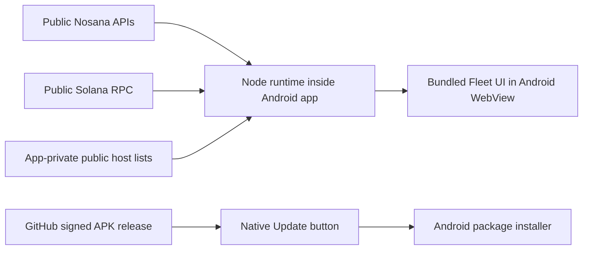

# GridLens for Android

The existing GridLens Fleet dashboard runs directly on Android, including its
public-data service. **The laptop can be off.** Internet access is still required
for current Nosana and Solana readings. This repository supports Android only;
the [desktop application](https://github.com/MachoDrone/gridlens-typescript)
continues independently.

**[Download the signed Android APK](https://github.com/MachoDrone/gridlens-android-releases/releases/latest/download/gridlens-android.apk)**

**Version 0.2.3** matches the reference Fleet column presentation: PC uses the
normal table text size; IP cycles hidden → public/private → public suffix → private
suffix; Rewards to claim uses rounded whole NOS links to the host’s Nosana page.
Exact amounts still drive sorting and remain in details. Enabled PC monitoring
now checks public egress from a verified node using ipify and reads the PC’s
private interface address, with one shared lookup per PC every 30 minutes.
The phone’s IP is never substituted, and old readings keep their source times.

Open a saved fleet and choose **Enable / repair monitoring** once if it is not
already enabled. Existing enabled monitoring picks up these IP reads after the
update; routine refresh needs no rescan. Install over the existing app without
uninstalling. See [rewards and GPU implementation](docs/REWARDS_AND_GPU_TELEMETRY_GAPS.md).

Android 8.0 or newer is required. This build includes arm64 phones and x86_64
emulators. It does not include 32-bit Android or an iPhone application. The first
release is an early Android build; see [verification](docs/VERIFICATION.md) for
what was actually checked.

## Use it

Install the APK and open GridLens. Android may ask you to allow installations from
your browser. The app opens **Network Discovery**. Choose **Search network** to
find reachable SSH services on Wi-Fi or your existing VPN, select computers and
review their SSH identities in native Android screens. Save a named fleet from
verified public Nosana addresses. Reopening it refreshes public Fleet data over
ordinary internet without another network scan or SSH login. Scans never start
automatically. **Fleets** manages saved fleets, network profiles and credentials.

SSH passwords and imported keys stay native and can be remembered encrypted with
Android Keystore. **Forget credentials** leaves saved fleets available. Container inventory is read-only. Monitoring setup separately approves its fixed
rewards reads and owned Docker recorder operations, including per-PC sudo when
needed; saved approval avoids recurring password prompts.
Full-tunnel VPNs may require learning the destination range once on-site or
entering it; GridLens does not guess all private networks or configure VPNs.
See [Network Discovery](docs/NETWORK_DISCOVERY.md) for supported layouts, limits
and physical acceptance. Online GPU Hosts remains an optional public scenario.

Use **Hosts** to import a JSON array of public host addresses for **Supplied Host
Addresses** or **Real200**. Select the list with Android's file picker. Only public
addresses belong in that file; no wallet/key exports. Imports validate the complete
list before replacing that selection, save it in the app's private storage and
keep the existing provider caches and limits. The APK contains no operator roster.

The Fleet table, Jobs history, country display, sorting, display controls, touch
navigation and freshness rules come from the recorded desktop source snapshot.
Android's Scenario selector adds Network Discovery and named saved fleets.
PC and IP show dated native discovery metadata for saved fleets. **Enable / repair
monitoring** uses existing trusted endpoints and saved credentials; new computers
still use normal native discovery. One native approval covers bounded in-node
rewards reads and owned GPU recorders. The app refreshes enabled PCs while their
fleet is open; GPU recording continues while the phone is closed. Expand **Jobs**
for GPU conditions observed within each reported job interval. Source failures,
unsupported readings and gaps stay visible, and cached amounts retain their
original timestamps. Keys and authorization headers are never exported to the
phone; the fixed rewards helper sends authorization only to Nosana and never
claims funds.

Phone and laptop have independent preferences, rosters and public-reader caches;
they do not synchronize. Unknown columns remain unknown. Provider limits and
network outages can leave values pending or stale on either device.

## Update

Press **Update**, then choose to install an available version. GridLens downloads
from the separate [Android releases repository](https://github.com/MachoDrone/gridlens-android-releases),
verifies the APK and opens Android's installer. On the first update, Android may
ask you to allow installations from GridLens. Confirm the installation. Lists and
settings survive app updates; uninstalling removes app-local data.

From 0.2.1, the app checks on opening/resuming at most once every six hours.
Update becomes green and bold when a compatible newer release is known; a failed
check retains previously confirmed availability. The label is the last check's
result, not a continuous background subscription. Pressing Update rechecks now;
download and installation still require confirmation. Older installed versions
must be checked manually once to obtain this behavior.

Publishing a new signed release makes it available to that button; a source-code commit alone is not an installable update. The download
repository's workflow watches version bumps on this repository's `main`, runs the
checks, builds and signs, then publishes the APK. It runs on a 15-minute schedule
or manually; GitHub can delay scheduled runs. See [development](docs/DEVELOPMENT.md).

## How it works



The local server binds only to phone loopback. Every request requires the app's
random session token and valid local Host/origin. The WebView loads bundled
GridLens content; external HTTPS links open the browser. No JavaScript-to-native
privileged bridge is exposed. Fixed user-initiated navigation opens native fleet
management; web content cannot supply SSH commands or credentials. Going into the
background suspends visible-page collection; this is not an always-running background monitoring service.

The native runtime is the full [fogtape Node.js Mobile 24.22.1-0 build](https://github.com/fogtape/nodejs-mobile/releases/tag/v24.22.1-0),
an explicitly pinned upstream prerelease based on Node 24.22.1. Its archive hash
and size are verified before building. Both 64-bit ABIs support 16 KiB page
alignment. The Java/native shell adds Android storage, lifecycle and installation;
it does not reimplement the Fleet data readers.

## Build

Use Node **24.14.1**, npm **11.11.0**, JDK **17** and the Android SDK. Build tools
are pinned; see [development](docs/DEVELOPMENT.md) for Android prerequisites and signing.

```sh
npm ci --ignore-scripts
npm run deps:vendor
npm run check
node tools/prepare-native.ts
cd android
./gradlew testDebugUnitTest assembleDebug
```

`npm run check` includes the original isolated application/browser checks. Install
their pinned browser first with `npx --no-install playwright install chromium`
from `vendor/gridlens`. A debug build has a different signing identity from the
downloaded release; it cannot replace or update a release installation.

The original MIT license and third-party notices are preserved, including in
the APK. [Source provenance](vendor/gridlens/PROVENANCE.json) records the upstream
commit, exact copied files and bounded mobile adaptations.
